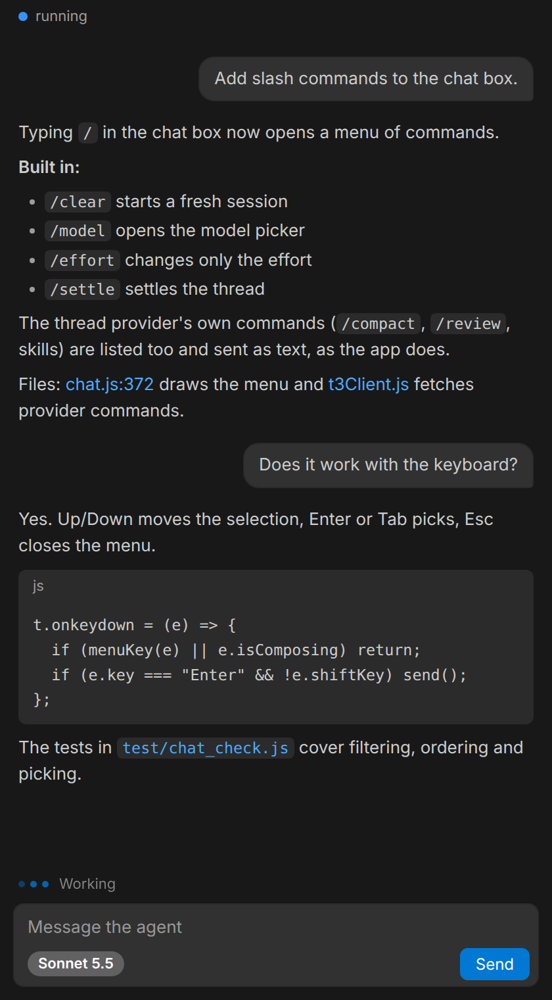
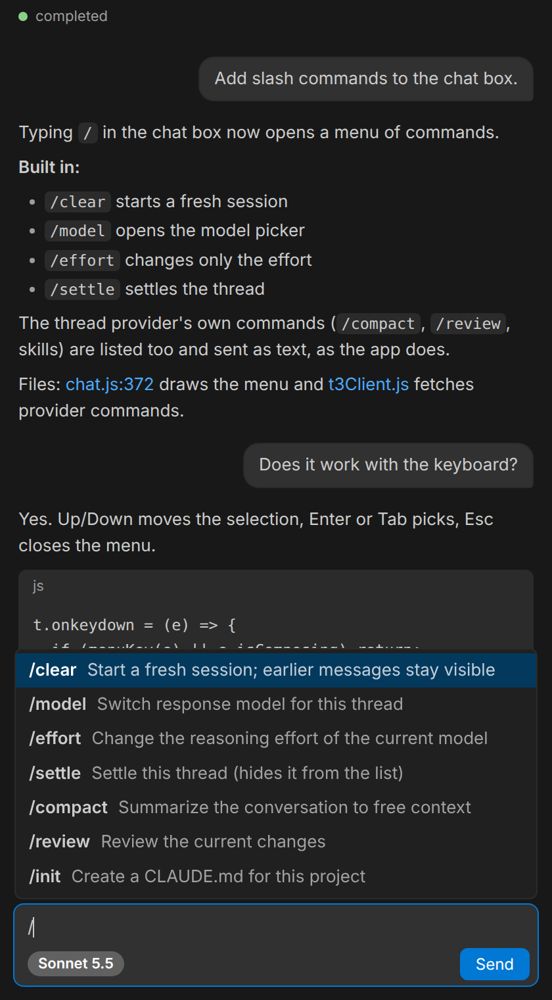
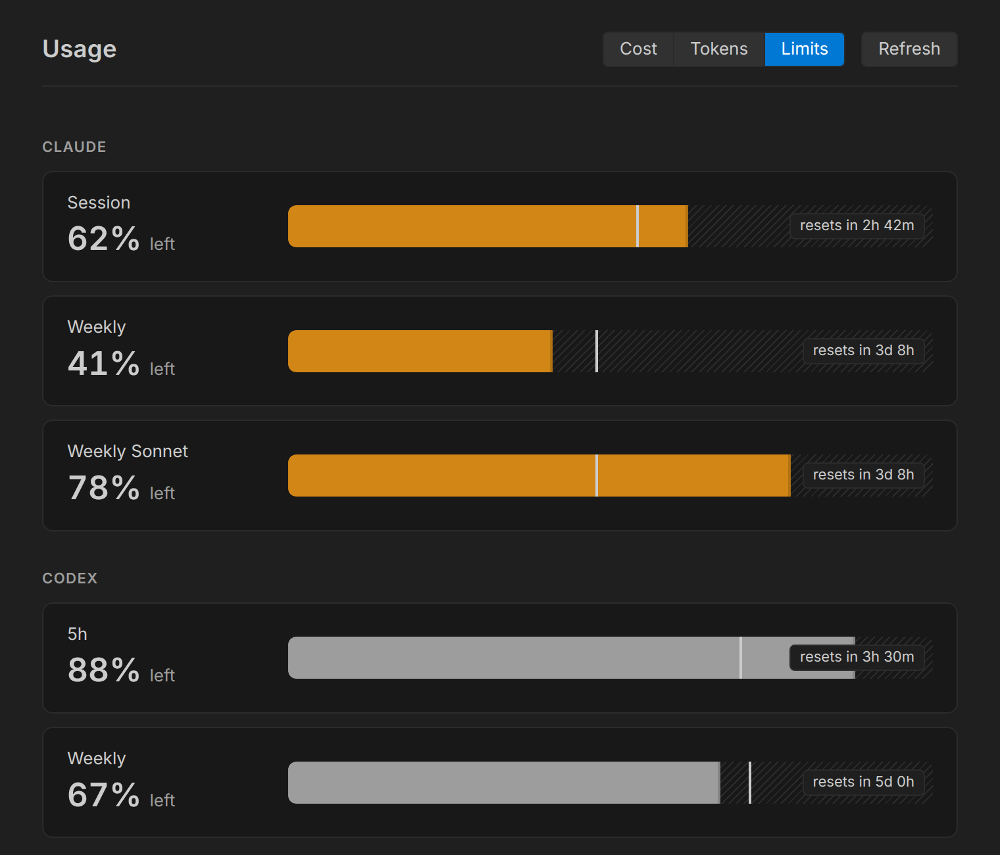

# Threads for T3 Code &mdash; Your Agent Threads in VS Code

> See every T3 Code thread of your workspace, chat with it, and send code to it &mdash; without leaving the editor.

**Unofficial.** This is a community project, not affiliated with or endorsed by T3 Tools Inc. "T3 Code" is used only to name the app this extension connects to.

A small, open-source VS Code client for the [T3 Code](https://t3.codes) server: one live WebSocket, no CLI. Plain JavaScript, no build step, no dependencies.

Agents run in the background, finish while you are reading a diff, or sit waiting for an answer. The T3 Code app shows them, but it is another window. This extension puts the threads, their chat and their file changes next to the code they are about.

<figure align="center">
  
</figure>

# Getting Started

1. **Run T3 Code** &mdash; the desktop app must be running, with your workspace folder added as a project.
2. **Install the extension** &mdash; see [Install](#install).
3. **Pair once** &mdash; run `t3 auth pairing create` in a terminal, then **`T3 Code: Connect to server`** in VS Code and paste the 12-character code. The extension trades it for a 30-day login kept in VS Code's secret storage (your OS keyring), limited to the `orchestration:read`, `orchestration:operate` and `diagnostics:read` scopes. When it expires or you revoke it, the status bar shows **T3: connect**: pair again.
4. **Open the view** &mdash; click the **T3 Code** icon in the activity bar. Your open threads are listed, child agents nested under the thread that started them.
5. **Click a thread** &mdash; its history opens in the Chat view below. Type to reply; your messages are sent as you, not as an agent.

# Know What Your Agents Are Doing &mdash; Threads and Status

Which agent is running, which one is waiting for you, which one failed? One glance at the sidebar answers it.

- **Live status icons** &mdash; spinning while running, a bell when waiting for you, a check when completed, an error mark when failed, pause when interrupted, a slash when cancelled.
- **Parents and children** &mdash; child agent threads are nested under the thread that started them. Settled and snoozed threads are hidden.
- **Status bar** &mdash; how many threads of the workspace are running. Click it to show the view. When not connected it says why: **T3: connect** (not paired; click to pair), a spinner (connecting), or a disconnect icon (server not reachable; click to retry now).
- **Finish notifications** &mdash; when a thread completes, fails, is interrupted or is cancelled, a notification offers **Open chat**.
- **Right-click a thread** &mdash; open it in the T3 Code app, send the current selection to it, or show the changes of its last turn.

# Talk to It &mdash; Chat View

Read the whole history and reply without switching windows.

<p align="center">
  
  &nbsp;&nbsp;
  
</p>

- **Enter sends**, Shift+Enter adds a new line.
- **Markdown and code blocks**, with citation quote cards that jump to the quoted reply.
- **Links that work** &mdash; file links and path-like code spans (`src/foo.js:42`) open in a VS Code editor at that line. Web links open in the browser.
- **Open-file chip** &mdash; shows the active file and selected lines (`extension.js:120-140`). When on, a send adds the file's absolute path and line range (not the code). Click the chip to leave it out.
- **Paste images** &mdash; Ctrl+V saves the image under `/tmp/t3-vscode-images/` and inserts its path.
- **Live replies** &mdash; text appears as the agent writes it, pushed by the server.
- **Model badge** &mdash; shows model and effort; click it to pick any model of an enabled provider (Claude, Codex, ...) and its effort level; another provider's model switches the thread to it.
- **Slash commands** &mdash; typing `/` opens a menu of the commands below plus the thread provider's own (Up/Down, Enter or Tab to pick, Esc to close). `/clear` makes the next message start a fresh session (earlier messages stay visible; click the banner to keep the current session). `/model` opens the model picker; `/effort` changes only the effort of the current model; `/settle` settles the open thread. Provider commands (`/compact`, `/review`, skills) are sent as text, as the app does. `/side` and `/btw` need the app.
- **Title-bar buttons** &mdash; refresh, open in the app, show the last turn's changes, and open the worktree in Source Control for threads that run in one.

# Send Code to an Agent &mdash; Editor Commands

Right-click a selection:

- **`T3 Code: Send selection (draft)`** &mdash; opens a new T3 Code draft with the file path, line range, selected code and diagnostics. Nothing is sent until you send it in the app.
- **`T3 Code: Send selection to thread`** &mdash; pick a thread, add an instruction, and send it. This starts an agent turn right away.
- **`Ask T3 to fix`** &mdash; on any squiggle, the light bulb selects the affected lines and opens a draft.

# See What Changed &mdash; Last Turn Changes

- **`T3 Code: Show changes of last turn`** &mdash; opens the files the thread's last turn changed in VS Code's diff editor (multi-file diff on recent VS Code, else a file picker).
- **Explorer badges** &mdash; files changed in the open thread's last turn get a "T3" badge.
- **Resume** &mdash; reopens your last thread when VS Code starts, unless it is settled or snoozed.

See the caveat under [Limits](#limits).

# Watch the Spend &mdash; Usage Dashboard

Run **`T3 Code: Open usage dashboard`**. It shows cost, tokens and cache savings for 7 or 30 days, a per-day chart, and a per-model table with the provider. Tokens with no known price are noted and left out of the cost.

The **Limits** tab shows how much of each provider's quota is left: a bar per window (session, weekly, ...), the time until it resets, and a tick marking where the bar would end at an even pace. A bar ending right of the tick means you are under pace.

<figure align="center">
  
</figure>

# Keybindings

| Keys (macOS: Cmd instead of Ctrl) | Command |
| --- | --- |
| Ctrl+Alt+Shift+D (with a selection) | Send selection (draft) |
| Ctrl+Alt+Shift+S (with a selection) | Send selection to thread (sends right away) |
| Ctrl+Alt+Shift+T | Focus the Chat view |

Change them in Keyboard Shortcuts (search for "T3 Code").

# Requirements

- The T3 Code server (desktop app or `t3 serve`) running on this machine, version 0.1.10, with the workspace
  folder added as a T3 Code project. The extension finds it through `$T3CODE_HOME/userdata/server-runtime.json`
  (default `~/.t3`).
- A pairing code once (`t3 auth pairing create`, see [Getting Started](#getting-started)). The extension
  itself never runs `t3`.
- VS Code 1.101 or later (its Node has a global `WebSocket`).
- A trusted workspace (the extension is disabled in Restricted Mode, since it runs `git` and sends messages).
  In remote windows it runs on the remote side, next to the T3 server.
- Opening links in the app uses `xdg-open` on Linux. On macOS, Windows and remote windows it uses
  VS Code's `openExternal`, which is less tested.

# Install

Try it without installing, in an Extension Development Host:

```sh
code --extensionDevelopmentPath=$HOME/code/t3-vscode /path/to/your/project
```

Install it for everyday use by linking it into your extensions folder, then restart VS Code:

```sh
ln -s $HOME/code/t3-vscode ~/.vscode/extensions/local.t3-vscode
```

# How it works

The extension keeps one WebSocket open to the local T3 server ([t3Client.js](t3Client.js)) and
nothing else talks to T3. Every change is pushed by the server; nothing polls.

| What | Over the connection |
| --- | --- |
| Login | `POST /oauth/token` once (pairing code -> 30-day bearer), then `POST /api/auth/websocket-ticket` per connect |
| Thread list, status bar, notifications | `orchestration.subscribeShell` (snapshot, then pushed changes) |
| Chat history | `orchestration.subscribeThread` (snapshot, then `message.updated` events) |
| Sending a message | `message.dispatch` with `createdBy: "user"` (`freshContext: true` after `/clear`) |
| New thread | `orchestration.launchThread` (model and modes of the project's newest thread) |
| Stop, settle, model and effort | `thread.stop`, `thread.settle`, `thread.model-selection.set` |
| Usage dashboard | `server.getUsageSummary`, `server.getConfig` |
| Draft from selection | `t3code://new?prompt=...&repo=...` deep link |
| Open in app | `t3code://threads/<environment>/<thread>` deep link |
| Last turn changes | `git diff` / `git show` on T3's checkpoint refs |

The connection reconnects by itself (1 s, doubling to 30 s) and re-reads `server-runtime.json` each
time, so a server restart on a new port is picked up. While not connected, the tree, chat and
dashboard show the reason, and sends and actions are refused with it. The protocol is internal to T3;
it was read from server 0.1.10 and may change in a T3 update.

# Agent dashboard

**T3 Code: Open agent dashboard** shows one card per thread, sorted: waiting for you, running, failed,
rest. Sub-agents nest under their parent. Running and waiting cards show their last message. Cards have
Open chat, Open in app, Changes (last turn's diff), Stop and Settle.
**Stop thread** (tree inline button, chat title bar) and **Settle thread** (tree context menu, chat title bar) work the same.

# Limits

- The sidebar covers the first workspace folder only.
- **New thread** needs the folder to be a T3 Code project already, and one thread in it to copy the model from
  (or a project default model). Otherwise start the first thread in the app.
- Questions and approvals are answered in the chat pane (approvals: Accept, Decline, Cancel only). Option previews and "always allow" are not shown; use the app for those. The wire format is T3-internal and may change.
- Subagents started inside a turn (not as T3 threads) do not appear in the tree.
- **Last turn changes and the "T3" file badges rely on T3 internals.** They read the git refs T3
  keeps per turn (`refs/t3/orchestration-v2/checkpoints/<hash of thread id>/ordinal/<N>`), which
  are not a public API and may change in any T3 update. They need the workspace to be a git
  repository. A turn that only chatted shows "changed no files".
- "Open worktree in Source Control" is untested: no worktree thread existed when it was written.

# Development

```sh
node --check extension.js && node --check t3Client.js && node --check media/chat.js
node test/chat_check.js       # markdown, escaping, citation, file-link and checkpoint-ref checks
node test/t3client_check.js   # thread list and message stores, pairing form, connection states
node test/usage_check.js && node test/dashboard_check.js
```

Reload the Extension Development Host window with Ctrl+R after a change.

Files:

- [extension.js](extension.js): commands, Threads tree, Chat view provider, status bar.
- [t3Client.js](t3Client.js): the connection to the T3 server (login, socket, stores, commands).
- [media/chat.js](media/chat.js), [media/chat.css](media/chat.css): the Chat webview (strict CSP,
  all message text escaped before rendering).
- [package.json](package.json): views, commands, menus.
- [test/chat_check.js](test/chat_check.js): self-check for the webview rendering.

# License

[MIT](LICENSE), Copyright (c) 2026 Riccardo Enrico.
