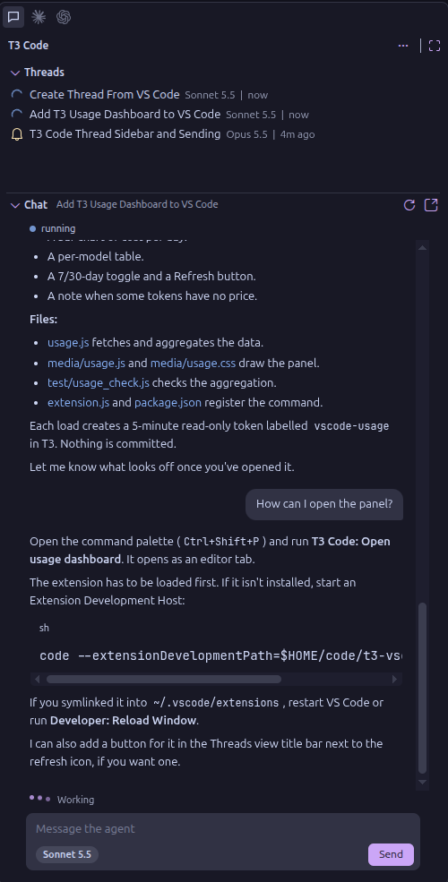
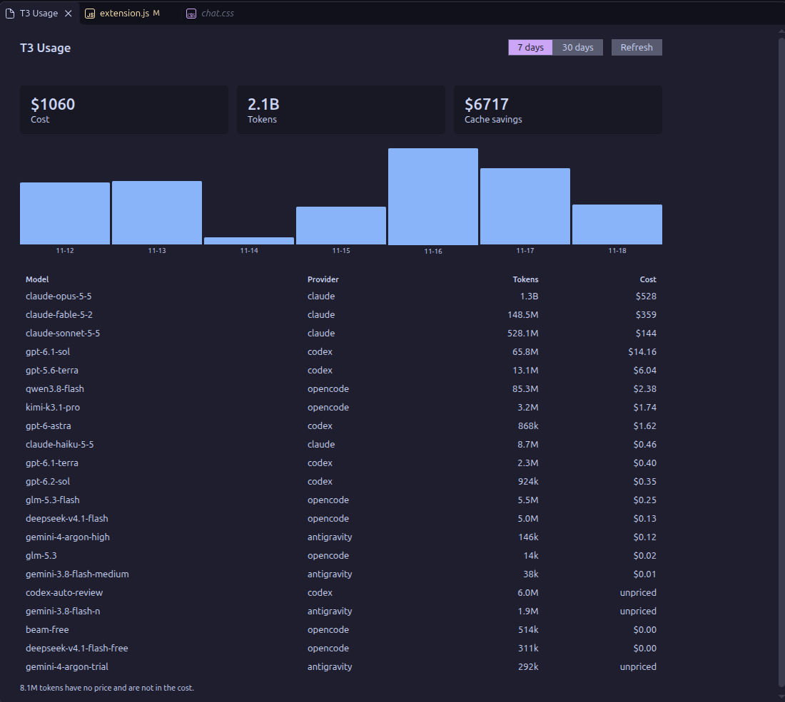

# T3 Code Bridge &mdash; Your Agent Threads in VS Code

> See every T3 Code thread of your workspace, chat with it, and send code to it &mdash; without leaving the editor.

A small, open-source VS Code extension that talks to [T3 Code](https://t3.codes) through the `t3` CLI. Plain JavaScript, no build step, no dependencies.

Agents run in the background, finish while you are reading a diff, or sit waiting for an answer. The T3 Code app shows them, but it is another window. This extension puts the threads, their chat and their file changes next to the code they are about.

<figure align="center">
  
</figure>

# Getting Started

1. **Run T3 Code** &mdash; the desktop app must be running, with your workspace folder added as a project.
2. **Install the extension** &mdash; see [Install](#install).
3. **Open the view** &mdash; click the **T3 Code** icon in the activity bar. Your open threads are listed, child agents nested under the thread that started them.
4. **Click a thread** &mdash; its history opens in the Chat view below. Type to reply.

# Know What Your Agents Are Doing &mdash; Threads and Status

Which agent is running, which one is waiting for you, which one failed? One glance at the sidebar answers it.

- **Live status icons** &mdash; spinning while running, a bell when waiting for you, a check when completed, an error mark when failed, pause when interrupted, a slash when cancelled.
- **Parents and children** &mdash; child agent threads are nested under the thread that started them. Settled and snoozed threads are hidden.
- **Status bar** &mdash; how many threads of the workspace are running. Click it to show the view.
- **Finish notifications** &mdash; when a thread completes, fails, is interrupted or is cancelled, a notification offers **Open chat**.
- **Right-click a thread** &mdash; open it in the T3 Code app, send the current selection to it, or show the changes of its last turn.

# Talk to It &mdash; Chat View

Read the whole history and reply without switching windows.

- **Enter sends**, Shift+Enter adds a new line.
- **Markdown and code blocks**, with citation quote cards that jump to the quoted reply.
- **Links that work** &mdash; file links and path-like code spans (`src/foo.js:42`) open in a VS Code editor at that line. Web links open in the browser.
- **Open-file chip** &mdash; shows the active file and selected lines (`extension.js:120-140`). When on, a send adds the file's absolute path and line range (not the code). Click the chip to leave it out.
- **Paste images** &mdash; Ctrl+V saves the image under `/tmp/t3-vscode-images/` and inserts its path.
- **Model badge** &mdash; shows model and effort; click it to pick any model of an enabled provider (Claude, Codex, ...) and its effort level; another provider's model switches the thread to it (needs the live connection; without it the click opens the app).
- **Title-bar buttons** &mdash; refresh, open in the app, show the last turn's changes, and open the worktree in Source Control for threads that run in one.

# Send Code to an Agent &mdash; Editor Commands

Right-click a selection:

- **`T3 Code: Send selection (draft)`** &mdash; opens a new T3 Code draft with the file path, line range, selected code and diagnostics. Nothing is sent until you send it in the app.
- **`T3 Code: Send selection to thread`** &mdash; pick a thread, add an instruction, and send it. This starts an agent turn right away.
- **`Ask T3 to fix`** &mdash; on any squiggle, the light bulb selects the affected lines and opens a draft.

# See What Changed &mdash; Last Turn Changes

- **`T3 Code: Show changes of last turn`** &mdash; opens the files the thread's last turn changed in VS Code's diff editor (multi-file diff on recent VS Code, else a file picker).
- **Explorer badges** &mdash; files changed in the open thread's last turn get a "T3" badge.
- **Resume** &mdash; reopens your last thread when VS Code starts, unless it is settled or snoozed.

See the caveat under [Limits](#limits).

# Watch the Spend &mdash; Usage Dashboard

Run **`T3 Code: Open usage dashboard`**. It shows cost, tokens and cache savings for 7 or 30 days, a per-day chart, and a per-model table with the provider. Tokens with no known price are noted and left out of the cost.

<figure align="center">
  
</figure>

# Keybindings

| Keys (macOS: Cmd instead of Ctrl) | Command |
| --- | --- |
| Ctrl+Alt+Shift+D (with a selection) | Send selection (draft) |
| Ctrl+Alt+Shift+S (with a selection) | Send selection to thread (sends right away) |
| Ctrl+Alt+Shift+T | Focus the Chat view |

Change them in Keyboard Shortcuts (search for "T3 Code").

# Requirements

- The T3 Code desktop app, running, with the workspace folder added as a T3 Code project.
- The `t3` CLI on your `PATH`, version 0.1.10 or later (`t3 --version`).
- VS Code 1.85 or later.
- A trusted workspace (the extension is disabled in Restricted Mode, since it runs `t3` and `git`).
  In remote windows it runs on the remote side, next to the `t3` CLI.
- Opening links in the app uses `xdg-open` on Linux. On macOS, Windows and remote windows it uses
  VS Code's `openExternal`, which is less tested.

# Install

Try it without installing, in an Extension Development Host:

```sh
code --extensionDevelopmentPath=$HOME/code/t3-vscode /path/to/your/project
```

Install it for everyday use by linking it into your extensions folder, then restart VS Code:

```sh
ln -s $HOME/code/t3-vscode ~/.vscode/extensions/local.t3-vscode
```

# How it works

| What | `t3` command |
| --- | --- |
| Thread list | `t3 thread list --project <workspace> --json` |
| Chat history | `t3 thread show --messages 1000 --json <thread>` |
| Sending a message | `t3 thread send <thread> -` (message on stdin) |
| Draft from selection | `t3code://new?prompt=...&repo=...` deep link |
| Open in app | `t3code://threads/<environment>/<thread>` deep link |
| Status bar, notifications | `t3 thread list` every 15 s (skipped if the tree just listed) |
| Last turn changes | `git diff` / `git show` on T3's checkpoint refs |

The chat polls for updates. It polls every second while the thread is running, or for 30 seconds
after you open a thread or send a message. Otherwise it polls every 10 seconds. It never polls
while the view is hidden. Each `t3` call costs about one second of CPU, which is why it does not
poll faster.

Before each timed poll the extension checks the modification time of T3's state database
(`$T3CODE_HOME/userdata/statev2.sqlite-wal`, default `~/.t3`). If it has not changed since the last
good poll, the `t3` call is skipped. Opening a thread, sending, or refreshing always polls. The file
changes every few seconds while any T3 thread runs, so this saves CPU mainly when T3 is idle.

# Live connection and agent dashboard

The extension keeps one WebSocket open to the local T3 server ([t3Client.js](t3Client.js)). It mints a
5-minute token with `t3 auth session issue` (scopes `orchestration:read`, `orchestration:operate`,
`diagnostics:read`) on each connect, then subscribes to the thread list. While connected:

- The Threads tree and the status bar update when the server pushes a change. The 15 s `t3` poll is off.
- **T3 Code: Open agent dashboard** shows one card per thread, sorted: waiting for you, running, failed, rest.
  Sub-agents nest under their parent. Cards have Open chat, Open in app, Stop and Settle.
- **Stop thread** (tree inline button, chat title bar) and **Settle thread** (tree context menu) use
  commands the CLI does not have.

If the connection fails, the old CLI polling path runs unchanged (it also needs the server, so it does not
help when the server is down). The protocol is internal to T3; tags were read from server 0.1.10.
The chat view still polls; approval text and the model picker are not done yet.

# Limits

- The sidebar covers the current workspace only (`t3 thread list` is per project, and the CLI has
  no command to list projects).
- No live streaming: replies appear on the next poll.
- Subagents started inside a turn (not as T3 threads) do not appear in the tree.
- **Last turn changes and the "T3" file badges rely on T3 internals.** They read the git refs T3
  keeps per turn (`refs/t3/orchestration-v2/checkpoints/<hash of thread id>/ordinal/<N>`), which
  are not a public API and may change in any T3 update. They need the workspace to be a git
  repository. A turn that only chatted shows "changed no files".
- "Open worktree in Source Control" is untested: no worktree thread existed when it was written.

# Development

```sh
node --check extension.js && node --check media/chat.js
node test/chat_check.js   # markdown, escaping, citation, file-link, state stamp and checkpoint-ref checks
```

Reload the Extension Development Host window with Ctrl+R after a change.

Files:

- [extension.js](extension.js): commands, Threads tree, Chat view provider, `t3` CLI calls.
- [media/chat.js](media/chat.js), [media/chat.css](media/chat.css): the Chat webview (strict CSP,
  all message text escaped before rendering).
- [package.json](package.json): views, commands, menus.
- [test/chat_check.js](test/chat_check.js): self-check for the webview rendering.

# Credits

The activity-bar icon ([icon.svg](icon.svg)) uses the T3 glyphs from the T3 Code logo
(`assets/prod/logo.svg` in [pingdotgg/t3code](https://github.com/pingdotgg/t3code)), MIT License,
Copyright (c) 2026 T3 Tools Inc.

# License

[MIT](LICENSE), Copyright (c) 2026 Riccardo Enrico.
